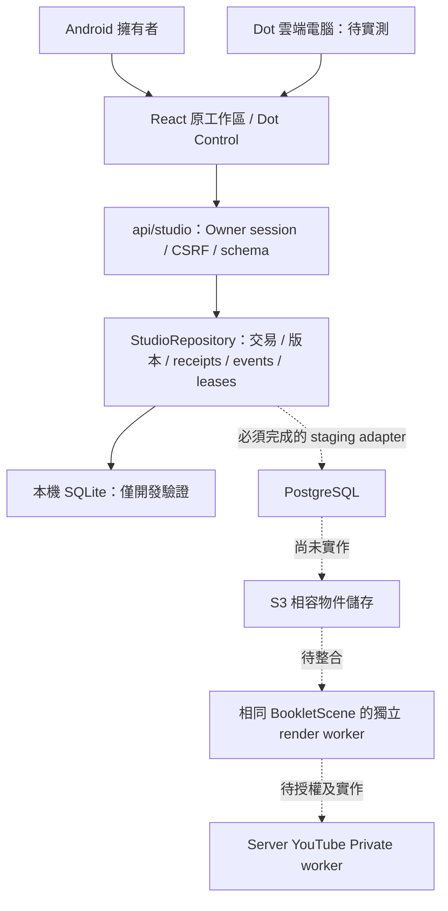

# Studio 2.0 架構與安全邊界

`studio/lrc.ts` 是逐行原文／翻譯契約。與舊 parser 不同，不會把同時間戳第二段原文假設為譯文。prefatory role+colon credits 只在第一句正文前清除，保留 removal audit；offset、亂序或不支援格式阻擋待審。原文字串保留，不自動進行繁簡或 Unicode 改寫。翻譯欄位替換逗號並留下修正記錄；繁簡異體、重複行缺變化只標記複核，沒有宣稱語意正確。

`server/studio/repository.ts` 使用 BEGIN IMMEDIATE、SQLite WAL、unique owner/idempotency key、不可變更 source/translation/events。這是實際可重開的本機 SQL 資料，非 in-memory mock。與 production PostgreSQL 尚未連接。交易內比較 source revision/hash 和本次精確 prompt hash；已收件結果同 key replay 返回原 receipt；不同內容不能覆寫。工作租約 120 秒、最多 3 次；過期 worker 的 token 不能提交。未 claim 的 owner 可直接透過語意化 UI 提交。

`server/studio/http.ts` 接收注入的 owner identity 以便測試；`api/studio.ts` 實際 handler 只使用現有加密 HttpOnly owner session，不支援測試身份／header 登入，不提供 Google token action。Cookie mutation 需要 origin + JSON + X-EME-Request。每 owner 每分鐘 60 mutation，local job 上限 1000、每 job 30 tracks、每 source 100 KB、每 request 200 KB。不存在 arbitrary URL fetch。資料 owner 篩選套用於 read、write、history、lease。

既有 Google access/refresh token 仍存在原架構的密封 Cookie，原本 browser token API 為**尚待遷移**的風險，未將其假稱 server credential vault。Studio 不會取用或返回 Google tokens。Scoped Dot capability 與專用無 Google 權限的 owner session 尚未實作，所以不可將現有完整 owner session 當成正式最小權限 Dot 授權。

`/render-probe` 僅產生合成 WAV、呼叫既有 renderTrack 與 BookletScene，不呼叫來源下載／YouTube API。IndexedDB 僅探針 scratch，finally 清理 probe input/output；顯示影片持有記憶體 Blob，重整即消失。正式素材 durable storage 與 render package integration 尚未實作。

舊的 CD-Booklet、MV/SRT、Threads、queue 與 library UI 繼續運作；只有 LRC sentinel 相容性變更。不能把保留舊功能視為新伺服器 pipeline 已完整接手。
